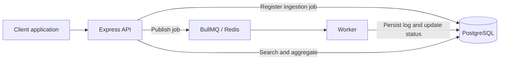

# Logs Microservices

[](https://github.com/helberjf/logs-microservices/actions/workflows/ci.yml)

An asynchronous log ingestion and search service built with **Node.js, Express, BullMQ, Redis and PostgreSQL**. Applications submit structured events over HTTP, track processing by job ID, and query persisted logs by service, severity, trace or attributes.

**Start here:** [Architecture](#architecture) · [Quick start](#quick-start) · [Try the API](#try-the-api) · [Engineering tradeoffs](#engineering-tradeoffs) · [Tests](#tests-and-quality) · [OpenAPI](docs/openapi.yaml)

## At a glance

| Area | What is implemented |
| --- | --- |
| Ingestion | Zod validation; one event or batches of up to 500; `202 Accepted` with job IDs |
| Background work | Separate API and worker processes; BullMQ retries with exponential backoff |
| Storage and search | PostgreSQL, JSONB attributes, full-text search, parameterized SQL and keyset pagination |
| Reliability | Optional `dedupeKey`, job status tracking and a PostgreSQL dead-letter table |
| Operations | Liveness/readiness endpoints, Prometheus metrics, migrations, retention script and Docker Compose |
| Verification | Vitest, Supertest, integration-capable CI and an end-to-end smoke script |

This is a focused backend implementation, not a complete observability product. In particular, ingestion deduplication does **not** establish exactly-once processing. The failure boundaries are documented below.

## Architecture



1. The API validates the payload and records an `ingest_jobs` row. A repeated `dedupeKey` returns the existing job ID.
2. New jobs are published to BullMQ. The API returns `202` after publication; the event may not yet be searchable.
3. The worker validates again, inserts the log and updates job status. Queue defaults allow five attempts with exponential backoff; worker concurrency is 10.
4. Clients poll ingestion status, then use search/detail endpoints. Exhausted retries are recorded in `ingest_dead_letters` when the failure handler can write to PostgreSQL.

The API and worker are separate processes in one repository and share a database. This keeps the example understandable while making asynchronous coordination visible.

## Quick start

**Requirements:** Docker with Compose. For local development and tests, use Node.js 20+ and npm.

```bash
git clone https://github.com/helberjf/logs-microservices.git
cd logs-microservices
docker compose up --build
```

Compose starts PostgreSQL and Redis, runs migrations, then starts the API and worker. In another terminal:

```bash
curl http://localhost:3000/health/liveness
curl http://localhost:3000/health/readiness
```

Stop the stack with `docker compose down`; the PostgreSQL named volume is retained. The checked-in Compose configuration is a local development setup with example database credentials and no API key.

<details>
<summary>Run the API and worker directly with Node.js</summary>

```bash
cp .env.example .env
npm ci
docker compose up -d postgres redis
npm run migrate
```

Start each process in its own terminal:

```bash
npm run dev:api
```

```bash
npm run dev:worker
```

In PowerShell, use `Copy-Item .env.example .env` instead of `cp` if needed.

</details>

## Try the API

The following example uses a POSIX shell. With Windows PowerShell, use `curl.exe` or the equivalent `Invoke-RestMethod` call.

```bash
curl -X POST http://localhost:3000/v1/logs \
  -H "Content-Type: application/json" \
  -d '{"ts":"2026-11-04T12:00:00.000Z","service":"billing-api","env":"dev","level":"info","message":"payment approved","traceId":"trace-123","dedupeKey":"billing:A1:approved","attrs":{"orderId":"A1"}}'
```

Example response:

```json
{"accepted":1,"jobIds":["<job-id>"]}
```

Use the returned ID to follow the event:

```bash
curl "http://localhost:3000/v1/logs/ingest/<job-id>"
curl "http://localhost:3000/v1/logs?service=billing-api&level=info&q=payment&limit=50"
curl "http://localhost:3000/v1/logs?traceId=trace-123"
curl "http://localhost:3000/v1/logs?attrKey=orderId&attrValue=A1"
curl "http://localhost:3000/v1/stats?bucketMinutes=60&service=billing-api&env=dev"
```

Resubmitting the same `dedupeKey` returns the original job ID and `duplicates: 1`, without publishing a second job. This also applies if the original job failed; duplicate submission is not a reprocessing mechanism.

Search returns `items` and `nextCursor`. Send `cursorTs` and `cursorId` together to continue. The current implementation returns a cursor for every non-empty page; a cursor alone does not prove that another page contains results.

| Endpoint | Purpose |
| --- | --- |
| `POST /v1/logs` | Accept one log or a batch |
| `GET /v1/logs/ingest/{jobId}` | Inspect `queued`, `processing`, `processed` or `failed` state |
| `GET /v1/logs` | Search with filters, time range, free text and cursor |
| `GET /v1/logs/{id}` | Retrieve one persisted log |
| `GET /v1/stats` | Counts by severity and time bucket |
| `GET /health/liveness` | Process liveness |
| `GET /health/readiness` | Dependency readiness |
| `GET /metrics` | Prometheus text-format metrics |

See the [OpenAPI contract](docs/openapi.yaml) for payloads and query parameters.

## Engineering tradeoffs

These tradeoffs explain the current implementation and its constraints; the comparisons below are not benchmark claims.

| Choice | Benefit | Cost or boundary; when to revisit |
| --- | --- | --- |
| Asynchronous API + BullMQ worker | The client does not wait for the final log insert; retries and worker concurrency are explicit. | Acknowledgement and persistence are separate. Clients need status polling, and the service must coordinate Redis and PostgreSQL. Revisit the publication boundary before claiming stronger delivery guarantees. |
| PostgreSQL + JSONB/full-text search | One store supports structured filters, flexible attributes and SQL aggregations, with indexes in [migrations](migrations). | Search and retention compete with writes. Evaluate a dedicated search system or partitioning when measured volume and query needs justify the operational cost. |
| Database-enforced `dedupeKey` at ingestion | A partial unique index resolves duplicate submissions and reuses a stable job ID. | This does not deduplicate worker inserts after a retry. The key is global, and reusing it with different content still returns the old job. Worker idempotency and key lifecycle need explicit policies. |
| Dead-letter records in PostgreSQL | Failed payloads and errors are inspectable with the same database tools. This is an explicit choice in the design document. | It is not a separate recovery queue, and there is no automated replay workflow. Database failure can also prevent the failure record from being stored. |
| Batched deletion for retention | A small script gives the current schema a usable retention mechanism without table partitioning. | It needs scheduling and deletes only `logs`; it does not expire ingestion history or dead letters. Larger datasets may warrant partitions and separate retention policies. |

### Reliability boundaries and next improvements

- **Publication gap:** inserting `ingest_jobs` and publishing to Redis are separate operations. A crash between them can leave a queued record with no queue job. A transactional outbox would make pending publication recoverable.
- **Retry gap:** inserting a log and marking its job processed are separate operations. Failure after the insert can produce duplicate logs on retry. A unique ingestion identity plus a transaction would address this boundary.
- **Partial batches:** events are handled concurrently rather than in one transaction. A failed batch response can coexist with already accepted events; clients need stable per-event dedupe keys.
- **Queue durability:** the sample Compose file does not configure durable Redis storage. Persistence, backup/recovery and failure-injection tests are needed before relying on it for durable production ingestion.
- **Access and scale:** the optional API key is shared, with no tenant isolation; the default rate limiter is in memory. Deployment hardening requires authentication policy, restricted origins/network exposure and shared limits as appropriate.

These are explicit improvement areas, not features claimed to be complete.

## Tests and quality

```bash
npm ci
npm run lint
npm test
```

Vitest and Supertest cover validation, search, metrics, ingestion deduplication, retention SQL and worker failure behavior. Several tests use mocked dependencies; the integration path additionally requires PostgreSQL, Redis and applied migrations.

```bash
# POSIX shell, with dependencies running and .env configured
RUN_INTEGRATION=1 npm test
```

For PowerShell, set `$env:RUN_INTEGRATION="1"` before `npm test`. The [CI workflow](.github/workflows/ci.yml) starts PostgreSQL/Redis, runs lint and migrations, and enables this integration path.

With the full Compose stack running:

```bash
npm run test:e2e
```

The [smoke script](scripts/e2e-smoke.js) exercises the running API-to-worker path. Test source and CI configuration describe coverage; they do not constitute a load benchmark or a production availability guarantee.

## Configuration and operations

| Variable | Default/example | Purpose |
| --- | --- | --- |
| `PORT` | `3000` | API port |
| `NODE_ENV` | `development` | Runtime environment |
| `API_KEY` | empty | If set, requires `x-api-key` on all endpoints, including health and metrics |
| `DATABASE_URL` | See [.env.example](.env.example) | PostgreSQL connection |
| `REDIS_URL` | `redis://localhost:6379` | Queue connection |
| `QUEUE_NAME` | `logs-ingest` | Shared API/worker queue name; avoid `:` |
| `RETENTION_DAYS` | `30` | Age cutoff for log deletion |
| `RETENTION_BATCH_SIZE` | `1000` | Rows deleted per batch |

The full-stack Compose service settings are defined in [docker-compose.yml](docker-compose.yml); copying `.env.example` alone does not pass `API_KEY` into those services.

`GET /metrics` exposes process uptime, request counts by method/route/status, ingestion counters and available BullMQ job counts. The endpoint tolerates a failed queue-count lookup.

`npm run retention` **deletes old log rows** using the configured database, age cutoff and batch size. It is an explicit maintenance command, not an automatically scheduled job.

## Code tour

A short review path through the implementation:

1. [Validation schemas](src/shared/schemas.js) — accepted event shape and search parameters.
2. [Ingestion and search routes](src/api/routes/logs.js) — deduplication, publication, parameterized queries and cursors.
3. [Queue defaults](src/lib/queue.js) and [worker](src/worker/worker.js) — retries, persistence and failure handling.
4. [Database migrations](migrations) — tables, JSONB/full-text indexes and dedupe constraint.
5. [Tests](test), [smoke script](scripts/e2e-smoke.js) and [OpenAPI](docs/openapi.yaml) — expected behavior and executable entry points.

Additional documentation: [operating guide](GUIDE.md).

## License

MIT, as stated by the project.
